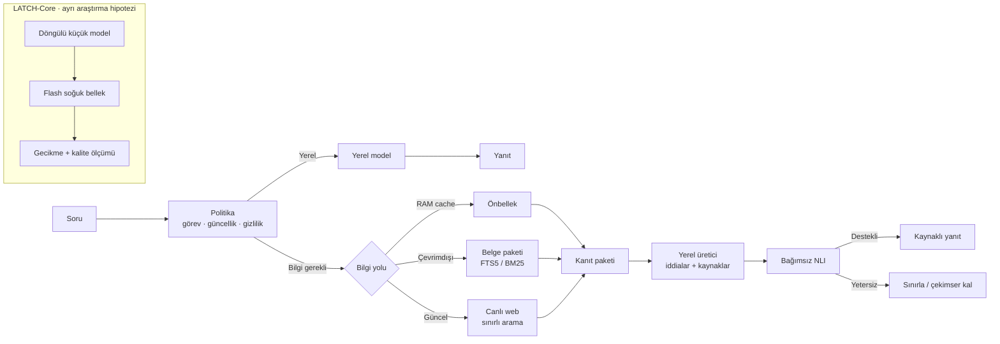

# LATCH

Düşük kaynaklı cihazlarda yerel muhakemeyi çevrimdışı bilgi paketleri ve canlı web erişimiyle birleştirmeyi inceleyen bir mimari öneri ve deney protokolü.

> **Durum:** Tasarım önerisi. Prototip ölçümü veya deneysel sonuç sunulmuyor; kaynak, gecikme, kalite ve güvenlik eşikleri hedef olarak tanımlanıyor.

## Mimari genel bakış

LATCH-Web mevcut bir yerel modeli bilgi kaynakları arasında yöneten ürün hattıdır. LATCH-Core flash erişim gecikmesini hesaplama sırasında örtme hipotezini sınar; LATCH-Web’in önkoşulu değildir.

## Makale

[Türkçe makale ve deney protokolü](LATCH_makale.docx)

Makale tarihi: 15 Ekim 2026.
