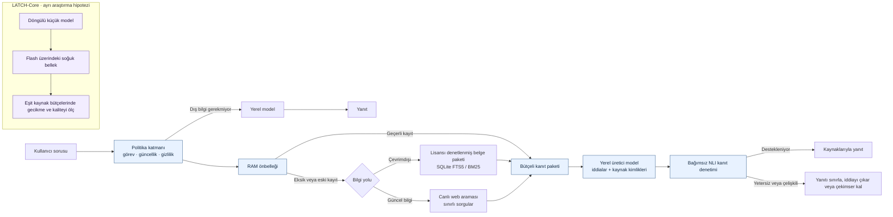

# LATCH

Düşük kaynaklı cihazlarda yerel muhakemeyi çevrimdışı bilgi paketleri ve canlı web erişimiyle birleştirmeyi inceleyen bir mimari öneri ve deney protokolü.

> **Durum:** Tasarım önerisi. Belge prototip ölçümü veya deneysel sonuç sunmuyor; kaynak, gecikme, kalite ve güvenlik eşikleri hedef olarak tanımlanıyor.

## Mimari genel bakış

LATCH-Web, mevcut bir yerel modeli bilgi kaynakları arasında yöneten ürün hattıdır. LATCH-Core ise flash belleğe erişim gecikmesinin hesaplama sırasında örtülüp örtülemeyeceğini sınayan bağımsız bir araştırma hipotezidir; LATCH-Web’in önkoşulu değildir.

## Makale

[Türkçe makale ve deney protokolü](LATCH_makale.docx)

Makale tarihi: 15 Ekim 2026.
